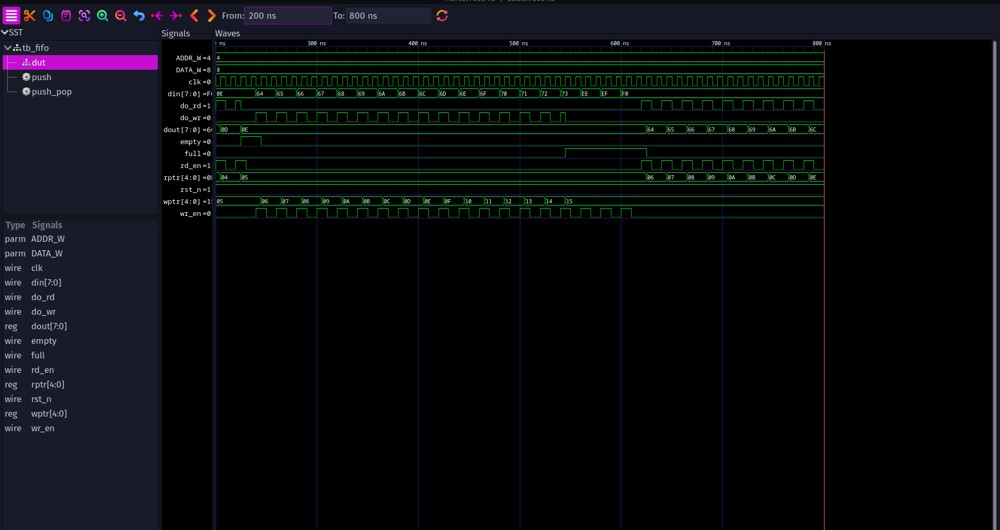

# Synchronous FIFO in Verilog

A parameterized synchronous FIFO (default: 8-bit data, 16 deep) with a
self-checking testbench. Simulated with Icarus Verilog and viewed in GTKWave.

## Design (`fifo.v`)
- Parameters: `DATA_W` (data width), `ADDR_W` (depth = 2^ADDR_W)
- Read/write pointers are one bit wider than the address:
  - `empty` when both pointers are equal
  - `full` when the lower bits match but the top (wrap) bit differs
- Writes are ignored when full, reads are ignored when empty
- Registered output `dout` (1-cycle read latency), active-low async reset

## Testbench (`tb_fifo.v`)
Self-checking: a reference model compares every read against the expected
value, and the `full`/`empty` flags are checked every cycle.

Tests:
1. Basic write/read
2. Fill to full + overflow attempts (extra writes must be ignored)
3. Drain to empty + underflow attempts
4. Simultaneous read and write
5. Simultaneous read/write at empty and at full
6. Reset in the middle of operation
7. 500 constrained-random operations

## Run it
    iverilog -g2012 -o sim fifo.v tb_fifo.v
    vvp sim
    gtkwave dump.vcd

Expected result: `RESULT: PASS`

## Waveform
Test 2 (fill to full, then rejected writes, then drain):

## Tools
Icarus Verilog, GTKWave

